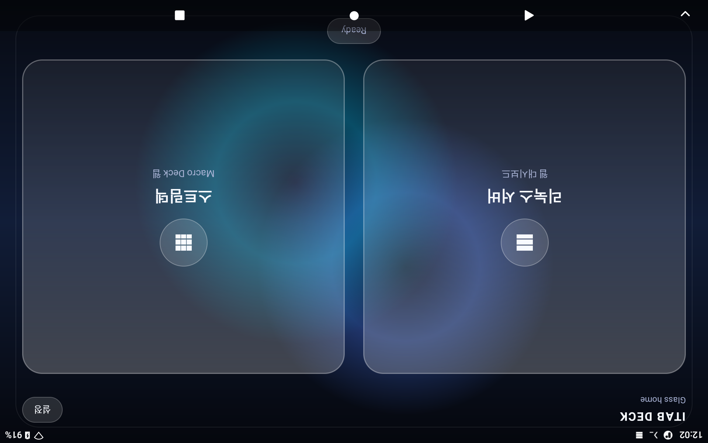
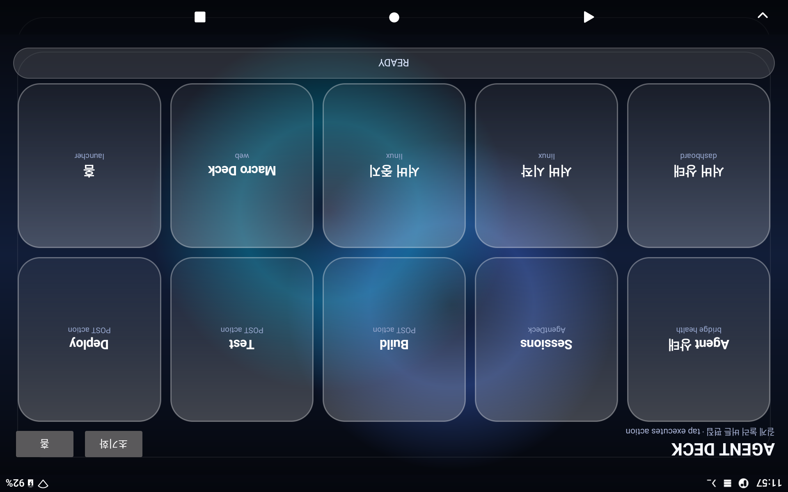
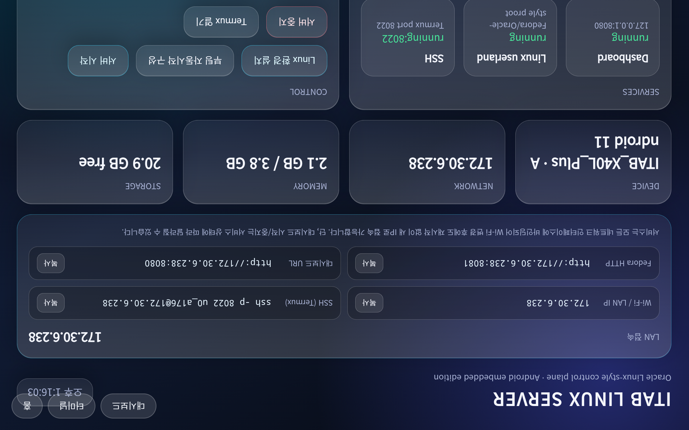
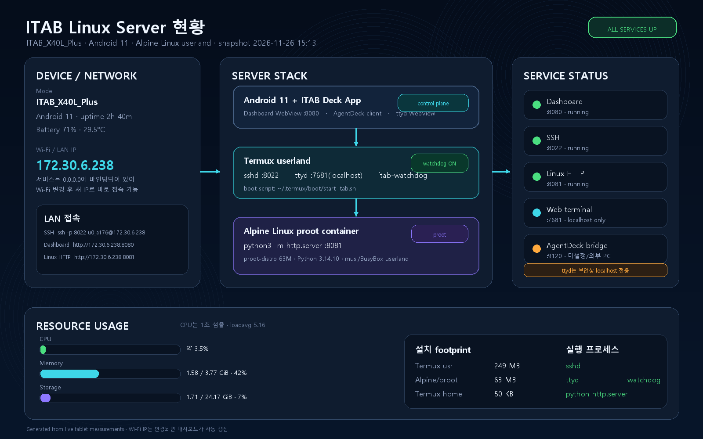

# ITAB X40L Plus — Stream Deck & Linux Server

ITAB X40L Plus 태블릿(Android 11 / Unisoc SC9863A)을 **AgentDeck 호환 스트림덱 + 경량 리눅스 서버 어플라이언스**로 개조한 프로젝트입니다.

## Screenshots









## What it does

- **스트림덱**: 개발 PC의 AgentDeck daemon에 WebSocket으로 연결해 AI 에이전트 세션을 버튼 타일로 표시·제어합니다.
  - 세션 상태 색상 표시 (작업 중 / 권한 대기 / 대기 / 오프라인)
  - 권한 요청 시 `한 번 허용 / 거부`, 옵션 프롬프트 시 실제 옵션 버튼 표시
  - `중단`, `ESC`, `재연결`, 사용량(`query_usage`) 표시
  - 에이전트별 브랜드 아이콘 (Claude, Codex, OpenCode, OpenClaw, Antigravity, Kiro, Hermes, z.ai)
  - UDP beacon 기반 브릿지 자동 검색 + 수동 endpoint/토큰/6자리 페어링 코드
- **태블릿 모드**: 일반 태블릿처럼 설치된 앱을 아이콘 그리드로 실행하고, `APK 설치` 버튼으로 SAF 파일 선택 → 패키지 설치까지 지원합니다. 앱 길게 누르면 시스템 앱 정보(삭제/비활성화) 화면으로 이동합니다. 홈 롤(`android.app.role.HOME`)을 이 앱에 지정해 HOME 키가 항상 이 런처로 돌아옵니다.
- **리눅스 서버**: Termux + proot-distro Alpine 위에서 SSH/웹 대시보드/웹 터미널을 제공합니다.
  - Dashboard `:8080` — 서비스 상태, LAN 접속 정보, 리소스 사용량
  - SSH `:8022` — Termux sshd
  - Linux HTTP `:8081` — Alpine `python3 -m http.server`
  - ttyd `:7681` — localhost 전용 웹 터미널
- **Watchdog**: sshd/Alpine HTTP/ttyd가 죽으면 20초 주기로 자동 재시작. `stop-itab.sh`로 중지하면 같이 멈춥니다.

## Hardware / OS

| 항목 | 값 |
|---|---|
| 모델 | ITAB X40L Plus (`ITAB_X40L_Plus`) |
| SoC | Unisoc SC9863A (`sp9863a` / `s9863a3h10`, 8x Cortex-A55) |
| OS | Android 11 (API 30), A/B + dynamic partitions, FBE |
| RAM | 4 GB |
| 저장공간 | userdata f2fs 24 GB — 현재 약 1.7 GB 사용 (8%) |

## Architecture

```text
ITAB X40L Plus (Android 11)
├── deck-launcher (com.itab.deck) — HOME 런처
│   ├── Glass home — 리눅스 / 스트림덱 / 태블릿 3개 카드
│   ├── DeckActivity — AgentDeck WebSocket 스트림덱
│   ├── TabletActivity — 앱 서랍 + APK 설치 (PackageManager)
│   └── LocalHttpServer :8080 — 대시보드 API + WebView
├── Termux (com.termux)
│   ├── sshd :8022
│   ├── ttyd :7681 (127.0.0.1 only)
│   ├── itab-watchdog.sh (20s loop)
│   └── proot-distro → Alpine Linux 3.24
│        └── python3 -m http.server :8081 (/srv/www)
└── 개발 PC
     └── AgentDeck daemon :9120 (WebSocket + UDP beacon :9121)
          └── adb reverse tcp:9120 (USB) 또는 같은 LAN 직접 접속
```

## Repository layout

| 경로 | 내용 |
|---|---|
| `deck-launcher/` | Android 앱 소스 (Gradle 프로젝트, `com.itab.deck`) |
| `device/` | 태블릿에 실제 배포된 스크립트 백업 (start/stop/watchdog, Alpine 서비스) |
| `tools/` | PC·태블릿 작업용 셸/파이썬 스크립트 모음 |
| `docs/` | 설정·연동·정리 가이드 |
| `docs/images/` | UI 스크린샷 및 서버 현황 다이어그램 |

## Build

요구 사항: JDK 17+, Android SDK (compileSdk 34), Gradle 8.7+

```powershell
$env:ANDROID_HOME = 'D:\path\to\android-sdk'
.\gradle-8.7\bin\gradle.bat -p deck-launcher assembleDebug
```

산출물:

```text
deck-launcher/app/build/outputs/apk/debug/app-debug.apk
```

설치:

```powershell
adb install -r app-debug.apk
```

## Device setup

상세 절차는 [docs/SETUP.md](docs/SETUP.md)를 참고하세요. 요약:

```bash
# Termux
pkg update -y
pkg install -y proot-distro openssh ttyd iproute2 curl
proot-distro install alpine
proot-distro login alpine -- sh -c '/sbin/apk add --no-cache python3 bash'

# 스크립트 배치 (device/ 참조)
# ~/.termux/boot/start-itab.sh  → 부팅 자동 시작
# ~/start-itab.sh / ~/stop-itab.sh / ~/itab-watchdog.sh
```

## AgentDeck connection

상세 절차는 [docs/AGENTDECK.md](docs/AGENTDECK.md)를 참고하세요.

```powershell
# PC: daemon 시작
node @agentdeck/bridge daemon start        # port 9120

# USB 연결 시 reverse
adb reverse tcp:9120 tcp:9120
# 태블릿 스트림덱 설정 → 127.0.0.1:9120

# 또는 같은 LAN에서 <PC-IP>:9120 + 6자리 페어링 코드
```

## Disk cleanup notes

조사/정리 내역은 [docs/CLEANUP.md](docs/CLEANUP.md)에 정리했습니다.

- Termux clang/llvm 체인 제거 (~511 MB)
- Payhere 주문 앱 제거 (~320 MB)
- Google 앱 데이터/캐시 정리 (~135 MB)
- Fedora userland → Alpine Linux 교체 (net ~250–300 MB)
- 결과: `/data` 24 GB 중 약 1.7 GB 사용 (8%)

## Snapshot & native OS plan

- **[backup/](backup/README.md)** — 현재 상태 스냅샷: Alpine rootfs, Termux home,
  패키지 목록, deck-launcher 설정, `/vendor` 파티션 풀. 바이너리 tarball은
  GitHub Release `snapshot-2026-11-26`에 첨부. Linux 서버 복구용이며
  부트로더급 brick 복구는 BROM 덤프가 필요합니다.
- **[docs/NATIVE_OS_PLAN.md](docs/NATIVE_OS_PLAN.md)** — SC9863A 네이티브 OS
  (Droidian/libhybris) 전환 계획: 순정 `.pac` 확보 경로, BROM 전체 파티션 덤프,
  언락 검증, 이미지 분석, 플래시 절차, 리스크.
- **[docs/device/](docs/device/)** — `getprop`, 파티션 맵, 부트 상태 캡처
  (`verifiedbootstate=green`, `oem_unlock_allowed=1`).

## Credits / References

이 프로젝트는 아래 오픈소스 프로젝트와 리소스를 참고했습니다.

- **[AgentDeck](https://github.com)** — 원본 스트림덱 프로젝트. WebSocket 프로토콜(`client_register`, `sessions_list`, `select_option`, `permission_decision`, `interrupt`, `escape`, `query_usage`), 세션 상태 모델, 페어링 흐름을 참고했습니다.
- **[lobe-icons](https://github.com/lobehub/lobe-icons)** — 에이전트 브랜드 아이콘 SVG (MIT 라이선스). PNG 변환 후 `drawable-nodpi`에 포함했습니다. 출처 표기: `deck-launcher/app/src/main/assets/agent-icon-attribution.txt`
- **[Termux](https://termux.dev)** — 안드로이드 리눅스 환경
- **[proot-distro](https://github.com/termux/proot-distro)** — Alpine 컨테이너
- **[Alpine Linux](https://alpinelinux.org)** — 경량 리눅스 userland (3.24)
- **[ttyd](https://github.com/tsl0922/ttyd)** — 웹 터미널
- **[OpenSSH](https://www.openssh.com)** — sshd
- **[Java-WebSocket](https://github.com/TooTallNate/Java-WebSocket)** — 앱 WebSocket 클라이언트
- **[Android Gradle Plugin](https://developer.android.com/build)** / Gradle
- **[sharp](https://github.com/lovell/sharp)** — 아이콘 PNG 변환 (개발 도구)
- **Teclast P20HD Droidian bringup** (`ex1tium/device-teclast-p20hd-n6h1`) — 동일 SoC(SC9863A) Linux 포팅 참고. 향후 네이티브 OS 실험 시 참조 예정
- **postmarketOS** — 네이티브 Linux OS 후보로 조사

## License

[MIT](LICENSE)

단, `res/drawable-nodpi/ic_agent_*.png` 에이전트 아이콘은 **lobe-icons (MIT)** 파생물이며 원 라이선스 고지가 필요합니다. 자세한 내용은 `deck-launcher/app/src/main/assets/agent-icon-attribution.txt`를 참고하세요.
